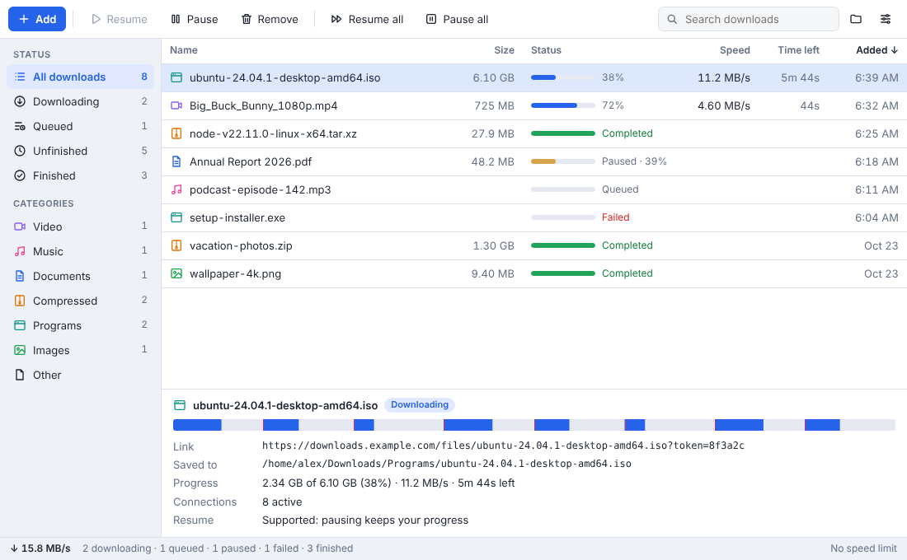

# Slipstream

A multi-connection download manager for Windows, macOS and Linux, modelled on
Internet Download Manager. It has a desktop app and a command-line tool that
share the same download engine.



## Desktop app

- **Fast downloads**: up to 32 connections per file, with IDM-style dynamic
  segmentation (see below). The details panel shows a live map of which parts
  of the file have arrived.
- **Pause and resume**, even after closing the app or a crash. Unfinished
  downloads continue when Slipstream starts (can be turned off).
- **Queue**: a set number of downloads run at once (3 by default); the rest
  wait their turn. "Download later" adds links without starting them.
- **Categories**: files are sorted into Video, Music, Documents, Compressed,
  Programs and Images folders inside your download folder, and the sidebar
  filters by category or status.
- **Adding links**: the Add button, pasting with Ctrl+V (⌘V) anywhere in the
  window, or dragging links in from a browser.
- **Tray icon**: closing the window keeps downloads going in the tray (can be
  turned off). The tray menu can pause or resume everything.
- **Notifications** when a download finishes, and a speed limit shared by all
  downloads.
- Light and dark themes follow the system.

Keyboard: Ctrl+N add, Ctrl+F search, Delete remove, Space pause/resume,
Enter open a finished file, arrows to move, Ctrl+A select all.

## Command line

```sh
slipstream https://example.com/big-file.zip                 # save in the current folder
slipstream -d ~/Downloads -c 16 https://example.com/x.iso   # folder, 16 connections
slipstream -o movie.mp4 --limit 2M https://example.com/v    # exact path, 2 MiB/s cap
slipstream -H "Cookie: session=abc" --referer https://site/page https://site/file
```

Press **Ctrl+C** to pause. Run the same command again to resume where it left
off. Run `slipstream --help` for every option (proxy, retries, timeouts, user agent).

## How it works

**Dynamic segmentation.** The file is not cut into fixed pieces up front.
When a connection becomes free it takes over the back half of whichever piece
has the most bytes left, so connections that finish early help slow ones
instead of sitting idle. When a connection reaches the end of its piece and
the neighbouring piece's connection has not received anything yet, it takes
that piece over on the same HTTP response, which saves a round trip. This
follows IDM's published description of its engine.

**Resume.** Each connection writes straight into `name.part` at its own
offset. Every 5 seconds, and on pause, the data is flushed to disk and the
piece positions are saved to `name.slipstream`. After a crash or power cut,
the download continues from the last save. If the server's file has changed
(different size, ETag or Last-Modified), the download starts over instead of
mixing two versions. Every request also carries `If-Range`, so a change in the
middle of a download is caught too.

**Falls back gracefully.** Servers that don't support byte ranges, or don't
report a size, get a single connection. Dropped connections are retried with
exponential backoff. Servers that limit connections end up with as many as
they allow.

**HTTP/1.1 on purpose.** HTTP/2 would multiplex every range request over one
TCP connection, which defeats the point of using several.

## Layout

| Path | What |
|---|---|
| `crates/engine` | Download engine: segmentation, resume, retries, speed limit |
| `crates/manager` | Download list, queue, categories, settings, saving the list |
| `crates/desktop` | Tauri desktop app; its page is plain HTML/CSS/JS in `ui/` |
| `crates/cli` | The `slipstream` command |
| `crates/test-server` | A deliberately misbehaving HTTP server used by the tests |

The app keeps its list and settings in the system's app-data folder
(`io.github.jook3r.slipstream`).

## Building

Install Rust from <https://rustup.rs>. On Linux, the desktop app also needs
WebKitGTK and a tray library:

```sh
sudo apt install libwebkit2gtk-4.1-dev libayatana-appindicator3-dev librsvg2-dev libxdo-dev
```

Then:

```sh
cargo run -p slipstream-desktop             # the desktop app
cargo build --release --workspace           # both programs, in target/release/
cargo test --workspace
```

The GitHub Actions workflow tests and builds on Windows, macOS and Linux and
uploads both programs as artifacts.

## Roadmap

1. ~~Engine: dynamic segmentation, resume, retries, speed limit~~
2. ~~Desktop app: download list, queue, categories, tray icon~~
3. Browser extension (Chrome/Edge/Firefox, Manifest V3) + native messaging
4. Video stream detection (HLS/DASH), ffmpeg muxing, scheduler, clipboard watch
5. Installers (MSI, DMG), auto-update
