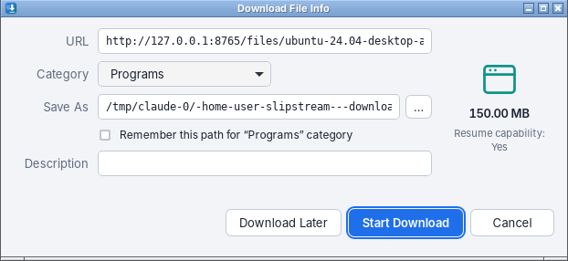
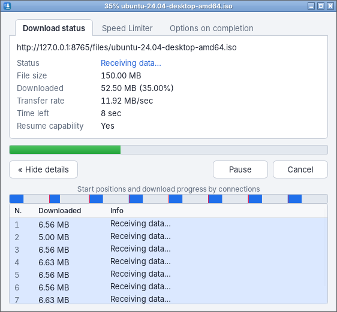

# Slipstream

A multi-connection download manager for Windows, macOS and Linux, modelled on
Internet Download Manager: a desktop app, a browser extension that hands it
your downloads, and a command-line tool, all sharing one download engine.


## Works like IDM

Click a download link in your browser and Slipstream takes it over. As in IDM,
a **Download File Info** window asks where to save it, then each download gets
its own **progress window**: status, transfer rate, time left, a per-download
speed limiter, and the connections at work. When it finishes, the same window
becomes **Download complete** with Open and Open folder buttons.

| Download File Info | Progress window |
|---|---|
|  |  |

The main window follows IDM's layout: a toolbar (Add URL, Resume, Stop, Stop
All, Delete, Delete Completed, Options, Start Queue, Stop Queue), a category
tree (Compressed, Documents, Music, Programs, Video… plus Unfinished and
Finished), and IDM's columns, with light and dark themes.

## Desktop app

- **Fast downloads**: up to 32 connections per file, with IDM-style dynamic
  segmentation (see below). The progress window shows a live map of which
  parts of the file have arrived.
- **Pause and resume**, even after closing the app or a crash. Unfinished
  downloads continue when Slipstream starts (can be turned off).
- **Queue**: a set number of downloads run at once (3 by default); the rest
  wait their turn. "Download Later" adds links without starting them.
- **Categories**: files are sorted into Compressed, Documents, Music,
  Programs, Video and Images folders inside your download folder. Tick
  "Remember this path" to give a category its own folder.
- **Adding links**: from the browser, with Add URL, by pasting with Ctrl+V
  (⌘V) anywhere in the window, or by dragging links in. Several links at once
  open a list to pick from.
- **Speed limits**: overall in Options, and per download in its window.
- **Tray icon**: closing the window keeps downloads going in the tray (can be
  turned off). Only one Slipstream runs at a time.

Keyboard: Ctrl+N add, Ctrl+F search, Delete remove, Space stop/resume,
Enter open, arrows to move, Ctrl+A select all. Double-click a download to
open its window.

## Browser extension

The `extension` folder holds one extension for Chrome, Edge, Brave, Vivaldi
and Firefox. Until it is published in the browsers' stores, install it by
hand:

- **Chrome, Edge, Brave, Vivaldi**: open `chrome://extensions` (Edge:
  `edge://extensions`), turn on **Developer mode**, click **Load unpacked**
  and choose the `extension` folder.
- **Firefox**: open `about:debugging#/runtime/this-firefox`, click **Load
  Temporary Add-on** and choose `extension/manifest.json`. (Firefox removes
  temporary add-ons when it restarts.)

Then open Slipstream once, so it can register itself with your browsers. Help
→ Browser integration in the app shows which browsers it found.

What the extension does:

- Takes over downloads of the file types on its list (IDM's list by default,
  editable in its popup), passing along the browser's cookies, referring page
  and user agent so downloads behind a login still work.
- **Alt+click** a link to let the browser download it instead.
- Right-click menu: **Download with Slipstream** on a link, and **Download
  all links with Slipstream** on a page or a selection.
- If Slipstream cannot be reached, the browser keeps the download, so nothing
  is lost. The popup shows whether it is connected.

How it fits together: the extension talks to `slipstream-bridge`, a small
program the browser starts through native messaging. The bridge passes each
link to the running app over a local connection protected by a random token
(and starts the app if it is not running). Run `slipstream-bridge --install`
or `--uninstall` to register or remove it by hand; the app does this itself
every time it starts.

## Command line

```sh
slipstream https://example.com/big-file.zip                 # save in the current folder
slipstream -d ~/Downloads -c 16 https://example.com/x.iso   # folder, 16 connections
slipstream -o movie.mp4 --limit 2M https://example.com/v    # exact path, 2 MiB/s cap
slipstream -H "Cookie: session=abc" --referer https://site/page https://site/file
```

Press **Ctrl+C** to pause. Run the same command again to resume where it left
off. Run `slipstream --help` for every option (proxy, retries, timeouts, user agent).

## How it works

**Dynamic segmentation.** The file is not cut into fixed pieces up front.
When a connection becomes free it takes over the back half of whichever piece
has the most bytes left, so connections that finish early help slow ones
instead of sitting idle. When a connection reaches the end of its piece and
the neighbouring piece's connection has not received anything yet, it takes
that piece over on the same HTTP response, which saves a round trip. This
follows IDM's published description of its engine.

**Resume.** Each connection writes straight into `name.part` at its own
offset. Every 5 seconds, and on pause, the data is flushed to disk and the
piece positions are saved to `name.slipstream`. After a crash or power cut,
the download continues from the last save. If the server's file has changed
(different size, ETag or Last-Modified), the download starts over instead of
mixing two versions. Every request also carries `If-Range`, so a change in the
middle of a download is caught too.

**Falls back gracefully.** Servers that don't support byte ranges, or don't
report a size, get a single connection. Dropped connections are retried with
exponential backoff. Servers that limit connections end up with as many as
they allow.

**HTTP/1.1 on purpose.** HTTP/2 would multiplex every range request over one
TCP connection, which defeats the point of using several.

## Layout

| Path | What |
|---|---|
| `crates/engine` | Download engine: segmentation, resume, retries, speed limits |
| `crates/manager` | Download list, queue, categories, settings, saving the list |
| `crates/desktop` | Tauri desktop app; its pages are plain HTML/CSS/JS in `ui/` |
| `crates/bridge` | `slipstream-bridge`, the browser's native messaging host |
| `crates/cli` | The `slipstream` command |
| `crates/test-server` | A deliberately misbehaving HTTP server used by the tests |
| `extension` | The browser extension (Manifest V3) |

The app keeps its list and settings in the system's app-data folder
(`io.github.jook3r.slipstream`).

## Building

Install Rust from <https://rustup.rs>. On Linux, the desktop app also needs
WebKitGTK and a tray library:

```sh
sudo apt install libwebkit2gtk-4.1-dev libayatana-appindicator3-dev librsvg2-dev libxdo-dev
```

Then:

```sh
cargo build --workspace                     # everything, in target/debug/
cargo run -p slipstream-desktop             # the desktop app
cargo test --workspace
```

Keep `slipstream-bridge` in the same folder as `slipstream-desktop`; the app
registers the bridge it finds next to itself.

The GitHub Actions workflow tests and builds on Windows, macOS and Linux and
uploads, for each, the app, the bridge, the command-line tool and the
extension together.

## Roadmap

1. ~~Engine: dynamic segmentation, resume, retries, speed limit~~
2. ~~Desktop app: download list, queue, categories, tray icon~~
3. ~~Browser extension, native messaging, IDM-style windows~~
4. Video stream detection (HLS/DASH), ffmpeg muxing, scheduler, clipboard watch
5. Installers (MSI, DMG), auto-update, publishing the extension
